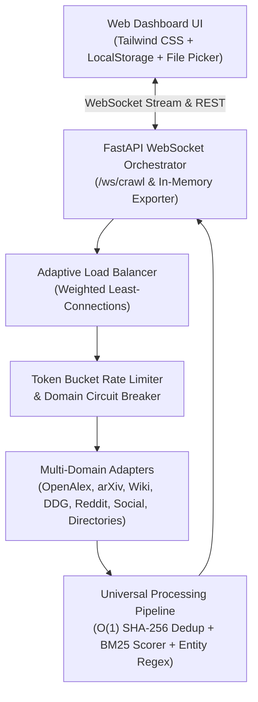

# ⚡ OmniCrawl Studio — Universal Local-First Multi-Platform Web Crawler

**OmniCrawl Studio** adalah mesin ekstraksi data web universal berbasis **Local-First & Zero-Server Storage Architecture** yang dibangun dengan **Python (FastAPI + Asyncio)**, **Playwright Stealth**, **`curl_cffi` TLS Impersonation**, dan **Modern Web UI Dashboard**.

Pengguna dapat melakukan *crawling* data topik apa saja lintas ekosistem (**Riset Ilmiah & Jurnal, Mesin Pencari Web, Media Sosial, Komunitas, Marketplace/Direktori, hingga Custom URL**) melalui antarmuka web lokal. Seluruh data diproses melalui pipeline algoritma efisiensi tinggi dan disimpan langsung ke **penyimpanan lokal browser/perangkat pengguna** tanpa membebani server dengan database.

---

## 🌟 Fitur Utama & Keunggulan Arsitektur

### 1. 🌐 Multi-Domain Platform Adapters (Universal Crawling)
Mendukung ekstraksi data paralel lintas 4 kategori platform:
* 🔬 **Research & Academic Platforms:** **OpenAlex** (250+ juta publikasi ilmiah, sitasi, DOI), **arXiv.org** (preprint sains & teknologi), dan **Wikipedia**.
* 🔎 **Search Engine & Custom Web:** **DuckDuckGo Web Search** (pencarian topik bebas di internet) dan **Custom URL Deep Scraper** (ekstraksi teks, harga, email, dan kontak dari daftar URL pilihan).
* 📱 **Social Media & Communities:** **Reddit** (diskusi komunitas & upvote), **Threads**, **Facebook**, **Instagram**, dan **TikTok**.
* 🏠 **Marketplace & Directories:** **Mamikos** dan **Direktori Web Terverifikasi**.

### 2. 🧠 Algoritma Efisiensi & Sistem Terdistribusi (`core/algorithms.py`)
* **Adaptive Load Balancing (*Weighted Least-Connections*):** Membagi beban kerja ke *worker pool* berdasarkan rasio koneksi aktif terendah (`active_connections / weight`), memilih worker dengan rata-rata latensi (`avg_latency_ms`) tercepat sebagai *tie-breaker*, dan merotasi *User-Agent* secara otomatis.
* **Per-Domain Rate Limiting (*Token Bucket Algorithm*):** Mengatur laju request per domain target secara asinkron untuk mencegah pemblokiran IP (*HTTP 429 Too Many Requests*).
* **Fault Tolerance (*Circuit Breaker Pattern* + *Full-Jitter Exponential Backoff*):** Memantau kegagalan per domain (`CLOSED` $\rightarrow$ `OPEN` $\rightarrow$ `HALF_OPEN`) dan melakukan *retry* cerdas dengan *exponential backoff* ber-jitter penuh.
* **Deduplikasi $O(1)$ (*SHA-256 Content Fingerprinting*):** Mengeliminasi URL dan konten duplikat lintas platform dalam waktu konstan $O(1)$.
* **BM25-Inspired Relevance Scoring (`core/universal_parser.py`):** Menghitung skor relevansi (`0–100%`) menggunakan saturasi frekuensi kata ala **BM25**, pencocokan kata kunci wajib (*must-include*) & pengecualian (*exclude*), filter rentang angka/tahun/harga, serta ekstraksi otomatis untuk **Email, Nomor Telepon/WhatsApp, DOI, Hashtag, dan Custom Regex**.

### 3. 💾 Zero-Server Storage Architecture
* **Browser `LocalStorage` Persistence:** Dataset hasil *crawling* disimpan langsung di browser pengguna sehingga tahan terhadap *refresh* halaman tanpa memerlukan database di sisi server.
* **In-Memory Streaming Export (`io.BytesIO`):** Konversi instan ke format **Excel (`.xlsx`)** dan **CSV (`.csv`)** di memori RAM yang langsung di-stream ke unduhan browser pengguna.
* **Native Local Folder Picker:** Mendukung *Browser File System Access API* (`window.showSaveFilePicker`) untuk menyimpan dataset langsung ke direktori lokal pilihan pengguna.

---

## 🏗️ Arsitektur Sistem & Design Patterns

Proyek ini menerapkan prinsip **Clean Code & SOLID** melalui pola desain berikut:
* **Strategy & Factory Pattern (`AdapterFactory` & `BasePlatformAdapter`):** Memudahkan penambahan platform baru secara modular tanpa mengubah logika inti orchestrator.
* **Bridge Pattern (`ExistingScraperBridgeAdapter`):** Menjembatani scraper spesifik ke dalam *Universal Processing Pipeline*.
* **Chain of Responsibility Pattern (`UniversalProcessingPipeline`):** Mengalirkan data mentah melalui tahapan normalisasi, ekstraksi entitas regex, validasi rentang angka, dan skoring BM25.
* **Observer / Pub-Sub WebSocket (`/ws/crawl`):** Mengirimkan telemetri *Load Balancer* dan progres *real-time* ke antarmuka web.



---

## 📂 Struktur Direktori

```text
C:\Script_Scraping\
├── app.py                        # FastAPI Server & WebSocket Orchestrator
├── static\
│   └── index.html                # OmniCrawl Studio Web UI Dashboard
├── start_web.bat                 # 1-Click Windows Launcher untuk Web Dashboard
├── main.py                       # CLI Runner & Test Suite
├── login_helper.py               # Otomasi login akun dummy & manajemen session cookies
├── config.py                     # Konfigurasi dasar & direktori
├── requirements.txt              # Daftar dependensi Python
├── .env.example                  # Template variabel lingkungan (aman untuk Git)
├── core\
│   ├── algorithms.py             # Load Balancer, Token Bucket, Circuit Breaker, SHA-256 Dedup
│   ├── universal_parser.py       # BM25 Relevance Scorer & Universal Regex Entity Extractor
│   ├── parser.py                 # Parser spesifik properti/kos
│   ├── exporter.py               # In-memory BytesIO Excel/CSV stream & file exporter
│   └── browser.py                # Playwright stealth context & cookie manager
├── scrapers\
│   ├── universal_adapters.py     # Strategy & Factory Adapters (OpenAlex, arXiv, Wiki, DDG, Reddit, dll)
│   ├── base_scraper.py           # Abstract base class scraper
│   ├── direct_kos_scraper.py     # Scraper direktori web
│   ├── mamikos_scraper.py        # Scraper marketplace Mamikos
│   ├── threads_scraper.py        # Scraper Threads
│   ├── fb_scraper.py             # Scraper Facebook
│   ├── ig_scraper.py             # Scraper Instagram
│   └── tiktok_scraper.py         # Scraper TikTok
└── .agents\
    └── skills\
        └── local-web-crawler\
            └── SKILL.md          # Antigravity Workspace Skill untuk orkestrasi AI
```

---

## 🚀 Instalasi & Cara Menjalankan

### 1. Persiapan Environment
```powershell
python -m venv venv
.\venv\Scripts\pip install -r requirements.txt
.\venv\Scripts\playwright install chromium
```

### 2. Menjalankan OmniCrawl Studio Web Dashboard (Direkomendasikan)
Klik dua kali file **`start_web.bat`**, atau jalankan melalui terminal:
```powershell
.\venv\Scripts\python app.py
```
Buka browser di **`http://localhost:8000`**.
* Pilih **Preset Skenario** (*Riset & Jurnal*, *Web & Tren Berita*, *Media Sosial*, atau *Properti & Kos*) atau ketik kueri bebas.
* Pantau telemetri *Load Balancer Worker Nodes* secara *real-time* dan unduh hasilnya langsung ke **Excel (`.xlsx`)**, **CSV**, atau **Folder Lokal**.

### 3. Menjalankan melalui CLI (Terminal)
```powershell
# Menjalankan simulasi pengujian parser:
.\venv\Scripts\python main.py --test

# Login interaktif satu kali untuk menyimpan sesi cookies media sosial (opsional):
.\venv\Scripts\python main.py --login instagram
```

---

## 🔒 Keamanan & Privasi
File kredensial (`.env`), sesi login (`sessions/`), dan hasil lokal (`data/`) secara otomatis dikecualikan oleh [`.gitignore`](.gitignore) agar tidak pernah terunggah ke repositori publik. Gunakan [`.env.example`](.env.example) sebagai acuan konfigurasi.
